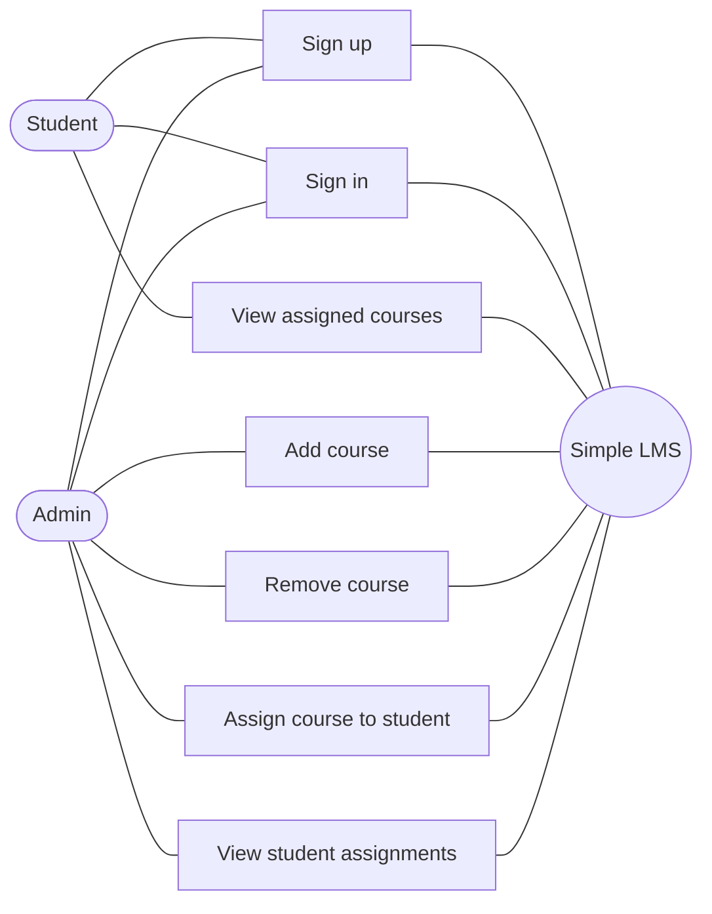
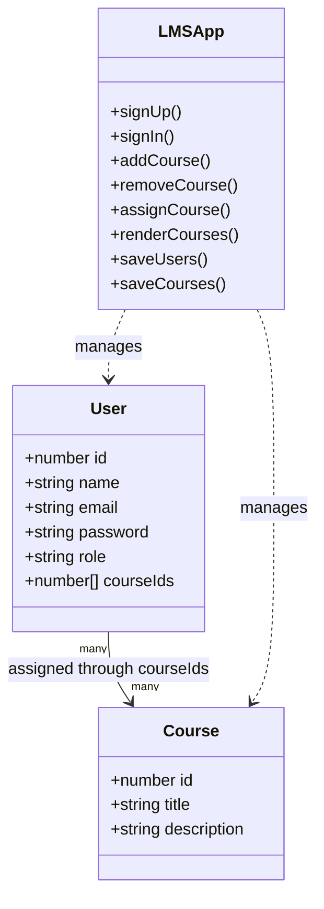
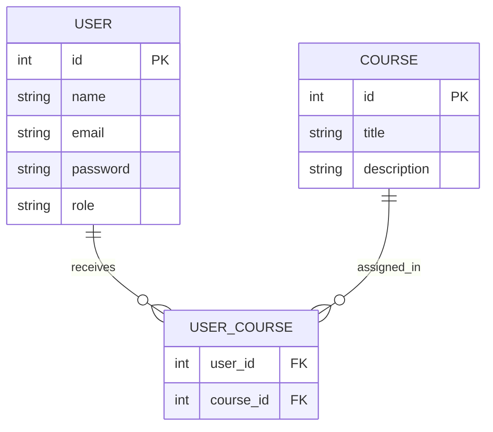
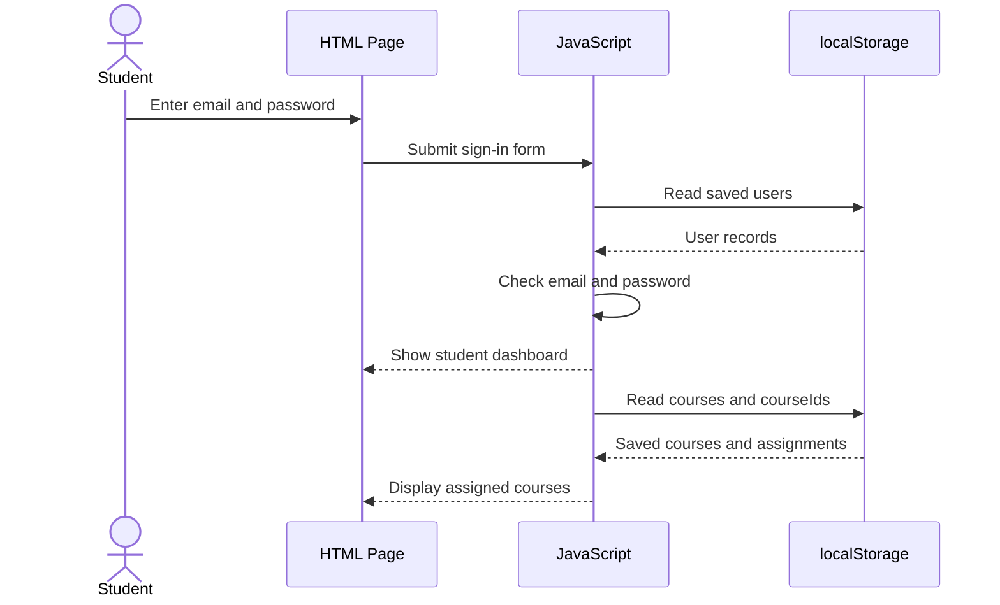
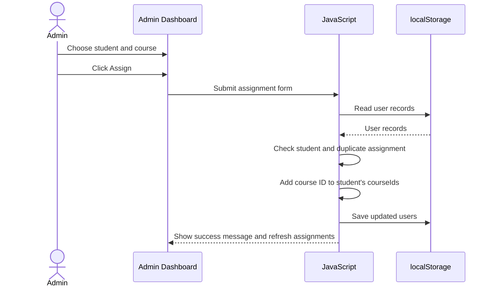

# Simple LMS - System Design Diagrams

These diagrams use Mermaid syntax. Paste each diagram into https://mermaid.live to view or export it.

## 1. Use Case Diagram

## 2. Class Diagram

## 3. ER Diagram

In this beginner project, `USER_COURSE` is represented by each user's `courseIds` array in local storage instead of a separate table.

## 4. Sequence Diagram - Student views assigned courses

## 5. Sequence Diagram - Admin assigns a course

## Important notes

- This is a front-end learning demo. `localStorage` is stored in one browser and is not shared between different users or devices.
- A real LMS should use a backend, a database, secure password hashing, and server-side role permissions.
- Letting anyone choose “Admin” on sign-up is okay only for this assignment demo. A real product must restrict who can become an admin.
